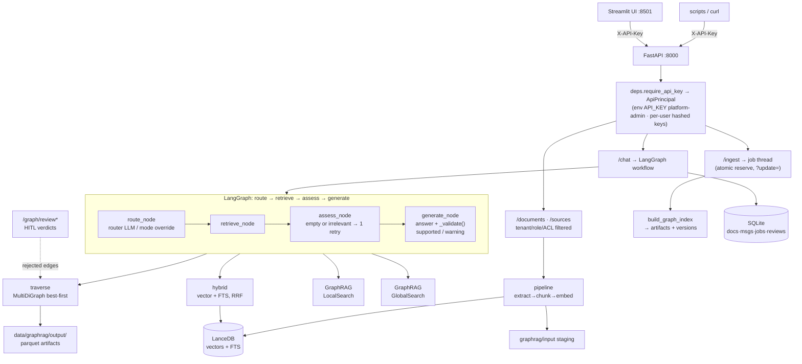

# University Knowledge Assistant — GraphRAG

An agentic GraphRAG system for multi-hop questions over university
documents. Upload docs → Microsoft GraphRAG builds a knowledge graph
(entities, relationships, communities, reports) → a LangGraph router
selects a retrieval strategy per question → answers come back with
source citations.

Full operations guide: **[docs/GUIDE.md](docs/GUIDE.md)** — agent
workflow deep-dive, configuration reference, run instructions,
evaluation evidence, and Streamlit screen walkthrough.

## Architecture



- **traverse** — guided multi-hop over the extracted knowledge graph:
  the router LLM decomposes the question into entity anchors, anchors
  seed a best-first expansion keeping several scored candidate paths
  per node (edge weight × description relevance, decayed by depth),
  expansion stops early once enough evidence is found, and weak
  evidence is pruned before ranking — depth is derived from the
  question, capped by `TRAVERSE_K_HOPS`. Temporal scoping (`as_of`
  param, a year in the question, or recency wording) deprioritizes
  mismatched-dated evidence. Hops are auditable: citations carry the
  entity path, alternate paths, relationship directions, extracted
  years, and path scores. Reviewer-rejected relationships are excluded
  from the graph (human-in-the-loop).
- **local** — GraphRAG LocalSearch: entity-anchored neighborhoods.
- **global** — GraphRAG GlobalSearch: map-reduce over community reports.
- **hybrid** — chunk-level vector similarity + full-text search, RRF-merged.

## Quick start

```bash
python3 -m venv .venv && .venv/bin/pip install -e .
cp .env.example .env        # set LLM_BASE_URL / LLM_API_KEY / models

# API (note: --loop asyncio is REQUIRED — graphrag_llm patches the loop)
.venv/bin/uvicorn app.main:app --port 8000 --loop asyncio

# seed + index + chat
.venv/bin/python scripts/seed.py --api http://localhost:8000
curl -X POST localhost:8000/ingest            # build the knowledge graph
curl localhost:8000/ingest/<job_id>           # poll until "done"
curl -X POST localhost:8000/chat \
  -H 'Content-Type: application/json' \
  -d '{"question": "Where is the lab directed by the professor who teaches CS-501?"}'

# UI
.venv/bin/streamlit run streamlit_app/app.py
```

Docker: `docker compose up` (api :8000, ui :8501) — embedded stores, no
external DB needed.

## Configuration (env / .env)

| Var | Default | Purpose |
|---|---|---|
| `LLM_PROVIDER` | `openai_compat` | `openai_compat` \| `anthropic` \| `ollama` \| `fake` |
| `LLM_MODEL` | claude-sonnet-4-6 | answer/graph-extraction model |
| `LLM_ROUTER_MODEL` | claude-haiku-4-5 | cheap routing model |
| `LLM_BASE_URL` / `LLM_API_KEY` | — | OpenAI-compatible endpoint; key falls back to `CLAUDE_API_KEY`/`OPENAI_API_KEY` |
| `EMBEDDING_PROVIDER` | `sentence_transformers` | `sentence_transformers` \| `openai` \| `voyage` \| `hash` (tests) |
| `EMBEDDING_MODEL` | `all-MiniLM-L6-v2` | shared by indexing AND query paths |
| `EMBEDDING_DIMS` | 384 | must match model; also sets GraphRAG `vector_size` |
| `TRAVERSE_K_HOPS` | 2 | max hop depth cap for traverse (depth adapts to the question) |
| `API_KEY` | — | break-glass platform-admin `X-API-Key`; required (strong) unless `ALLOW_INSECURE_AUTH` — see below |
| `ALLOW_INSECURE_AUTH` | `false` | local-dev escape hatch: run with no auth when `API_KEY` is unset — startup refuses otherwise |
| `AUTH_FAIL_LIMIT_PER_MINUTE` | 10 | failed-key attempts per client IP before `429` |
| `MAX_UPLOAD_BYTES` | 25 MB | upload size cap → `413` when exceeded |
| `LANGFUSE_PUBLIC_KEY` / `LANGFUSE_SECRET_KEY` / `LANGFUSE_HOST` | — | optional Langfuse tracing (only when the package is installed) |
| `GRAPHRAG_COMMUNITY_LEVEL` | 0 | community level for global search |
| `GRAPHRAG_MAX_GLEANINGS` | 1 | entity-extraction passes |

### Multi-tenant authorization

The app is multi-tenant: universities (`tenants`) are a hard isolation
boundary that no grant can cross. Users authenticate with per-user
`X-API-Key`s (sha256-hashed at rest, shown once at issuance/rotation);
`API_KEY` remains as the break-glass platform admin.

Roles, most to least privileged: `platform_admin`, `university_admin`,
`hod`, `faculty`, `student`, `guest`. Document access
(`app/authz.py`, evaluated in order): tenant boundary → privileged
admin → owner → explicit grant → restricted-classification deny →
department/course scope → classification default (`public` = tenant,
`internal` = non-guests) → deny. Grants are additive allow-only, valid
only inside the document's tenant, and revocable instantly.

Every retriever and graph endpoint consumes the caller's concrete
`doc_scope` — an empty scope means no access, never unrestricted.
Scoped callers are rerouted off GraphRAG LocalSearch/GlobalSearch
(which can't enforce per-document auth) to `traverse`/`hybrid`; the
substitution is reported as `requested_route`. Graph browse endpoints
serve strictly-provenanced views — an entity, relationship, community
or report is exposed only when *all* its supporting text units come
from authorized documents. Deleting a document revokes it everywhere
immediately (stale artifacts are pruned at read; `/graph/stats` reports
`stale` until the next `POST /ingest`).

### Provider-agnostic LLMs

`app/rag/llm.py` is the only interface the app calls. Providers live in
`app/rag/providers/` (anthropic, openai_compat, ollama, fake). Swap by
env only; add a vendor with one file + registry entry. GraphRAG's
internal LLM calls go through LiteLLM to the same endpoint.

### Embedding consistency

One `EmbeddingProvider` instance serves BOTH document indexing
(`embed_documents`) and queries (`embed_query`). Chunks record
`embedding_model`; vector search only compares against the active
model — changing `EMBEDDING_MODEL` requires `scripts/reindex.py`
(re-embeds chunks) **and** a graph rebuild (`POST /ingest`) since
GraphRAG's entity embeddings use the same provider via a custom
`local_st` type registered into `graphrag_llm`.

## API

All routes except `/healthz`/`/readyz` require `X-API-Key: $API_KEY`
when `API_KEY` is configured (unset → auth disabled for local dev).

| Route | Purpose |
|---|---|
| `POST /documents` | upload (multipart, `?classification=&department_id=&course_id=&tenant_id=`) → extract/chunk/embed — write-capable role |
| `GET /documents`, `DELETE /documents/{id}` | list / remove — ACL-filtered; delete = owner or admin, `?reindex=true` queues a rebuild |
| `POST /documents/{id}/grants`, `DELETE /documents/{id}/grants/{grant_id}` | additive allow-grants (user \| role \| department \| course), same-tenant only |
| `POST /ingest` | async GraphRAG index job (`?update=true` = incremental merge); `GET /ingest/{job}` status — write role required |
| `POST /chat` | `{question, mode?, conversation_id?, k?, as_of?}` → answer + route rationale + citations + `warning` when sources disagree; `requested_route` reports scoped reroutes |
| `GET /sources/{doc_id}` | source document text (citation drill-down; re-authorizes each read) |
| `GET /graph/{stats,entities,relationships}` | scoped graph browsing; `stats` reports `stale`/`stale_documents` after deletions |
| `GET /graph/subgraph/{entity}?depth=` | neighborhood subgraph for visualization (scoped) |
| `GET /graph/review/queue`, `POST /graph/review`, `GET /graph/review` | human review of extracted relationships (rejected edges leave the traversal graph) |
| `POST /tenants`, `GET /tenants` | tenant management — platform admin (list: own tenant for uni-admins) |
| `POST /users`, `GET /users`, `PATCH /users/{id}` | user lifecycle with anti-escalation role matrix — admins only |
| `POST /users/{id}/rotate-key` | mint a fresh key (old stops working instantly); self or admin |
| `POST /departments`, `GET /departments`, `POST /courses`, `GET /courses` | catalog management — tenant-scoped admins |
| `POST /enrollments`, `GET /enrollments` | course enrollment/instructor assignment — hod-or-above, never self-approved |
| `GET /audit` | audit events (tenant-scoped for uni-admins) |
| `GET /healthz`, `GET /readyz` | liveness / index-readiness |

## Evaluation

```bash
.venv/bin/python scripts/eval_retrieval.py     # recall@k + MRR + multi-hop path accuracy
.venv/bin/python scripts/eval_qa.py            # multi-hop answer correctness (needs API + index)
.venv/bin/python scripts/eval_benchmark.py     # vector vs FTS vs hybrid vs traverse side-by-side
.venv/bin/python scripts/eval_quality.py       # CI gate: ruff + pytest (+ --with-retrieval floors)
```

CI runs `scripts/eval_quality.py` via **GitLab CI** (`.gitlab-ci.yml`;
details in [docs/CICD.md](docs/CICD.md)). `--with-retrieval`
additionally enforces recall/coverage floors and is meant for a seeded
environment — the offline suite can't build an index.

## Tests

```bash
.venv/bin/python -m pytest        # fully offline (fake LLM + hash embedder)
.venv/bin/ruff check .
```

## Notes & limitations

- `--loop asyncio` is required: `graphrag_llm` calls `nest_asyncio2.apply()`
  at import, which cannot patch uvloop.
- GraphRAG indexing is LLM-heavy (extraction + community reports).
  `POST /ingest?update=true` runs GraphRAG's incremental path, which
  diffs input against the previous index and merges only new/changed
  content. Every successful build snapshots `output/` to
  `output.versions/<ts>` (last 5 kept) and the pre-build copy restores
  automatically on failure.
- `GRAPHRAG_COMMUNITY_LEVEL` must match levels actually produced by
  Leiden — small corpora produce only level 0.
- Authorization is structured multi-tenant RBAC/ABAC (tenants, roles,
  departments, courses, enrollments, ownership, grants) — see
  "Multi-tenant authorization" above. Legacy `doc_group` databases are
  migrated by Alembic: documents join the `local` tenant with
  `owner_id` left NULL (ownership is never fabricated).
- Schema changes are Alembic migrations (`alembic upgrade head`, run at
  startup); SQLite DBs get a timestamped file backup before each run.
- `POST /ingest` allows one live job (atomic in-process); a
  multi-worker deployment would need DB-level coordination.
- Citation validation (`VALIDATE_SYSTEM`) is one cheap router-model
  call that grades each snippet against the answer — `supported=false`
  flags and `warning` (contradicting sources) are advisory, they don't
  rewrite the answer.
- Per-node timings + counts land on `Message.metrics`; Langfuse tracing
  activates only when the package + keys are present.
- Temporal filtering is heuristic: years are regex-extracted from
  text units and edge descriptions, so it catches stated dates, not
  inferred validity intervals.
- Relationship review verdicts key on content hash (source+target+
  description) — they survive reindexing, and a changed description
  re-queues the item for review.
