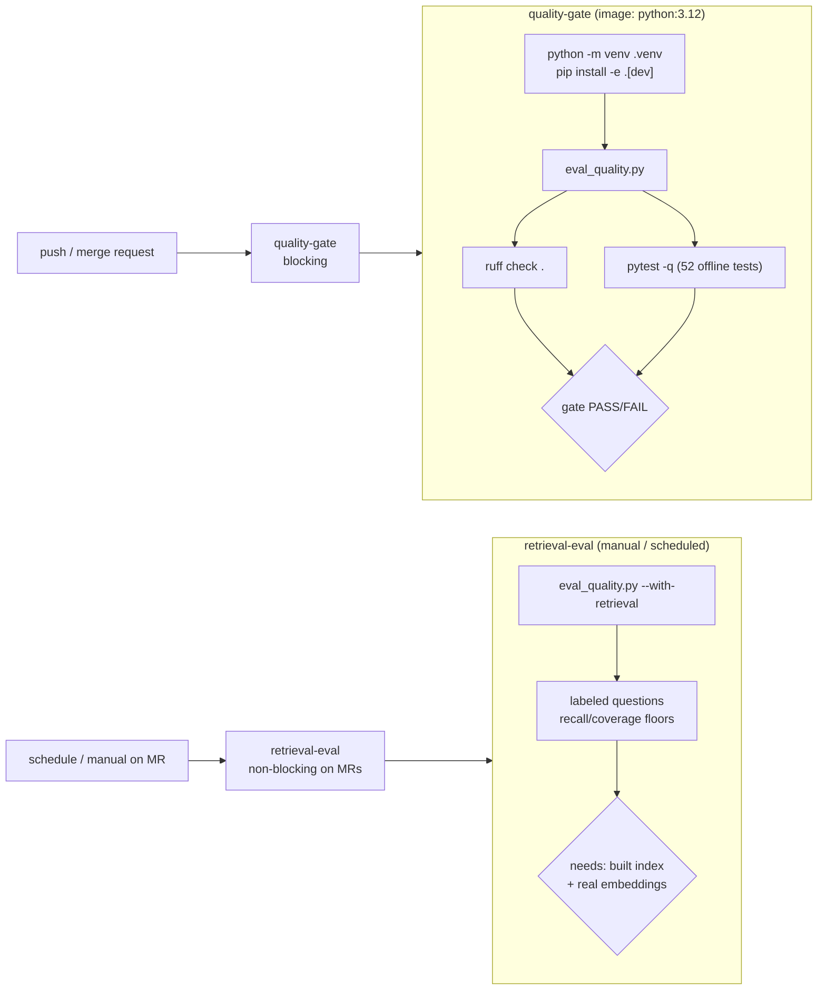
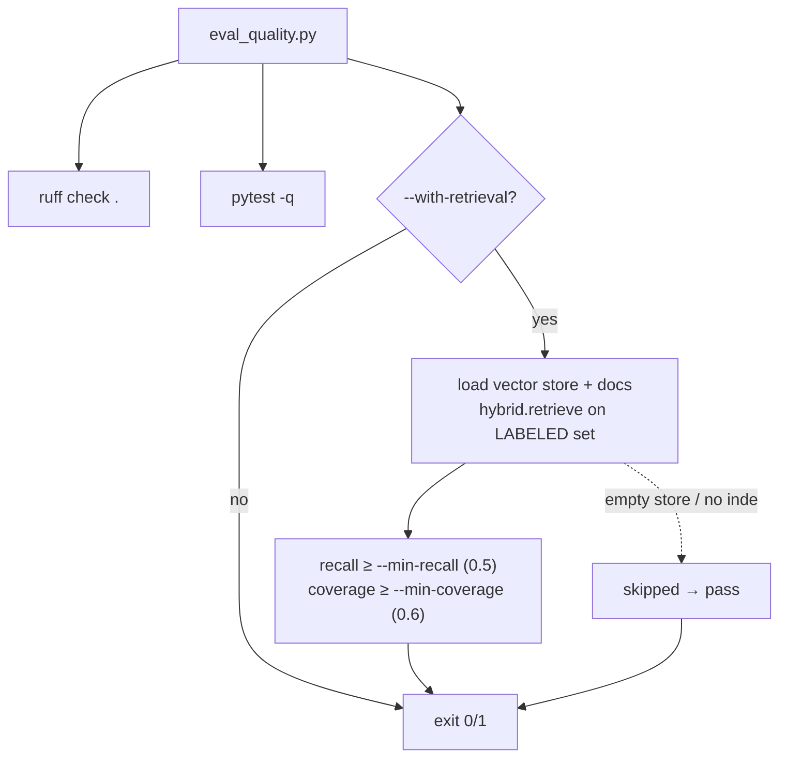

# CI/CD — GitLab pipeline

The pipeline is a **quality gate**, not a deployment pipeline: it
proves lint + the offline test suite on every push/MR, with an optional
deep retrieval-eval job for seeded environments.

Author: venkateshwara doijode

## Pipeline file

`.gitlab-ci.yml` — two jobs in one `test` stage:



## What runs where

| Job | Trigger | Blocking? | What it does |
|---|---|---|---|
| `quality-gate` | push to `main`/`master`, every MR | yes | `scripts/eval_quality.py` → `ruff check .` + `pytest -q` |
| `retrieval-eval` | pipeline schedules; manual on MRs | no (`allow_failure`) | `--with-retrieval` → hybrid recall/coverage floors on the labeled set |

`retrieval-eval` is manual because it needs `data/graphrag/output`
artifacts + sentence-transformers + a reachable LLM gateway — none of
which an ephemeral runner has. Run it on a self-hosted runner with
`.env` and seeded `data/` present, or on a nightly schedule.

## Local dry run (identical steps to the pipeline)

```bash
python -m venv .venv && .venv/bin/pip install -e ".[dev]"
.venv/bin/python scripts/eval_quality.py            # == quality-gate job
.venv/bin/python scripts/eval_quality.py --with-retrieval  # == retrieval-eval job
```

## Gate internals — `scripts/eval_quality.py`



Any failed sub-check flips the exit code — the job log prints
`:: label: PASS|FAIL` lines per check so failures are grep-able.

## Notes

- Self-hosted runners: tag this project to a runner with
  `python:3.12` Docker access. For `retrieval-eval`, the runner needs
  the repo's `data/` state and `LLM_*`/`EMBEDDING_*` env (CI/CD
  variables).
- There is no deploy stage — deployment is `docker compose up`
  locally; add a `deploy` stage here if the project gains a target
  environment.
