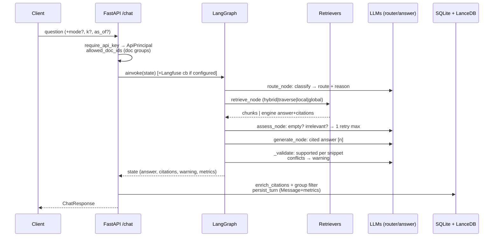
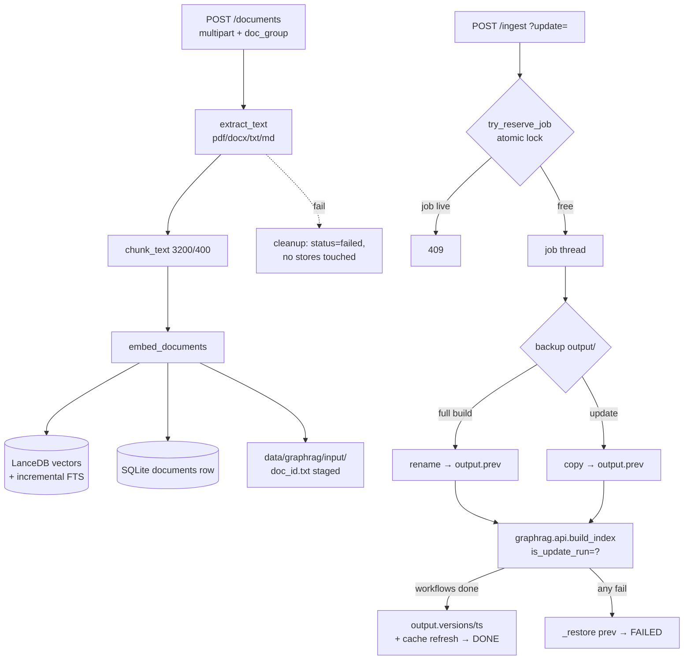

# Operations guide — University GraphRAG Assistant

End-to-end walkthrough: how the agent works, what to configure, how to
start and run it, and how to read the evaluation evidence.

Author: venkateshwara doijode

---

## 1. How the agent works

### Agent workflow (`POST /chat`)



### Traverse — the multi-hop path (most novel piece)

```mermaid
flowchart LR
    Q[question] --> D1[decompose<br/>router LLM → entity anchors]
    D1 --> L1["link per anchor<br/>exact→alias→fuzzy→embedding"]
    L1 --> EX["best-first expand<br/>MultiDiGraph ±direction<br/>score = weight×relevance×decay"]
    EX --> B{{bounds}}
    B -->|cycle per path| EX
    B -->|frontier ≤64, 3 paths/node| EX
    B -->|early stop @ max_items| EV[evidence]
    B -->|temporal rescore<br/>as_of/recency| EV
    EV --> P[prune < 25% top score]
    P --> F["filter: allowed_doc_ids<br/>+ rejected rel_keys"]
    F --> C[citations: hop_path<br/>edge_directions, alt_paths]
```



1. **Decompose** — router LLM lists the question's entity anchors in
   traversal order (`DECOMPOSE_SYSTEM`). Falls back to `[question]`
   when no LLM is available; depth then uses the full cap.
2. **Link** — each anchor resolves to graph entities via a ladder:
   exact substring → alias (honorifics stripped, acronyms,
   word-boundary safe) → fuzzy n-gram (`SequenceMatcher`) → embedding
   similarity. Earlier tiers short-circuit later ones.
3. **Expand** — best-first over a `nx.MultiDiGraph`. Each relationship
   is one directed edge; traversal crosses edges either way but records
   per-hop `edge_directions` (forward/backward). Path score =
   normalized edge weight × description relevance, decayed by depth.
   Up to 3 candidate paths per node, 64-path frontier cap.
4. **Bound** — cycles prevented per path; expansion stops early once
   `max_items` evidence is collected; evidence scoring below 25% of
   the top score is pruned before ranking.
5. **Temporal** — `as_of` param > year in question > recency words
   ("currently", "latest") resolve a temporal scope; future-dated
   evidence under `as_of` is penalized ×0.3, stale evidence on recency
   questions ×0.7.
6. **Filter** — `allowed_doc_ids` (RBAC groups) drops out-of-scope
   evidence; reviewer-rejected `rel_key`s never enter the graph.

### Human-in-the-loop review

`/graph/review/queue` lists unreviewed relationships; `POST /graph/review`
records `approved`/`rejected` keyed by content hash (source+target+
description) — verdicts survive rebuilds, changed descriptions re-queue.
Rejected edges are excluded inside `build_graph`.

### Ingestion



Failure semantics: embed-before-mutate + partial-row cleanup;
pre-build output snapshot restores on any build failure; one live job
at a time (atomic reservation).

### End-to-end, step by step (with code references)

#### A. Document upload — `POST /documents`

1. `app/api/routers/documents.py::upload` — requires a write-capable
   key (`require_write`), reads the file, enforces `MAX_UPLOAD_BYTES`
   (413), calls `save_upload` → file lands in `data/uploads/`.
2. A `Document` row is inserted (`status=uploaded`, `doc_group` from
   the `?doc_group=` param, default `"default"`).
3. `app/ingestion/pipeline.py::process_document` runs inline:
   a. `extract.py::extract_text` — pdf/docx/txt/md → plain text.
      Failure → status `failed`, error stored, nothing else written.
   b. `chunk_text` — splits into 3200-char chunks, 400-char overlap.
   c. `embed_documents` — the shared provider vectors all chunks.
   d. `LanceChunkStore.add_chunks` — rows `{chunk_id, document_id,
      text, vector, embedding_model}` written to LanceDB, then FTS
      `optimize()` (incremental, not a rebuild).
   e. `status=chunked` committed; a `{doc_id}.txt` copy is staged into
      `data/graphrag/input/` for the next index run.
4. Failure after step 3b deletes the partial LanceDB rows and the
   staged file — no orphaned vectors.

#### B. Graph indexing — `POST /ingest[?update=true]`

1. `ingestion.py::trigger_index` (write key) →
   `jobs.py::try_reserve_job` under a process lock: any pending/running
   job → 409, else creates the `IngestionJob` row and spawns a daemon
   thread atomically.
2. `run_index_job` (own DB session) → `asyncio.run(build_graph_index(update))`.
3. `graph_index.py::build_graph_index`:
   a. `register_local_embedding` — injects our `EmbeddingProvider`
      into `graphrag_llm` as type `local_st` (shared-model invariant).
   b. `ensure_settings` — writes `settings.yaml` (litellm completion
      model = raw name, `vector_size=EMBEDDING_DIMS`,
      `update_output_storage=output.updates`).
   c. Backup: full build renames `output/` → `output.prev`; update run
      *copies* it (the merge reads the previous index in place).
   d. `graphrag.api.build_index(is_update_run=...)` runs the pipeline:
      load docs → chunk → LLM extract entities/relationships →
      Leiden communities → community reports → embeddings.
   e. Every workflow must report done; else `_restore` rolls `output/`
      back to the snapshot and the job records FAILED.
   f. Success → `_archive_version` copies `output/` to
      `output.versions/<ts>` (keeps last 5), `load_artifacts(refresh=True)`
      swaps the in-memory graph, job row → DONE + row counts.
4. Poll `GET /ingest/{job_id}` — `stats.workflows` shows per-workflow
   status, `stats.incremental` records update runs.

#### C. Question — `POST /chat`

1. `chat.py::chat` — `require_api_key` resolves the `ApiPrincipal`;
   `_allowed_doc_ids` maps the principal's groups → document ids
   (`None` = unrestricted admin).
2. `graph.ainvoke(state)` — state carries `question, mode, k, as_of,
   allowed_doc_ids`. A Langfuse `CallbackHandler` attaches when
   configured. Each node is wrapped by `_timed` → `state.metrics`.
3. **route_node** — `router.py::route_with_reason`: `mode` override
   short-circuits (`reason = "mode override: X"`), else the router LLM
   answers `ROUTE_SYSTEM`; the regex `\b(hybrid|traverse|local|global)\b`
   picks the first token by position (no substring false hits).
   Fallback `hybrid`.
4. **retrieve_node** dispatches:
   - `hybrid` → `HybridRetriever.retrieve`: `embed_query` → LanceDB
     `vector_search` (filtered to active `embedding_model` + allowed
     doc ids) + `fts_search` → RRF fusion → top-k `RetrievedChunk`s.
   - `traverse` → `traverse()`: artifacts loaded (mtime-keyed cache),
     rejections loaded, the 6-step pipeline from §1 runs. Exception →
     logged, falls back to hybrid with `expanded=True`.
   - `local`/`global` → GraphRAG search objects compose their own
     answer + citations (no generate step); no index → fixed
     insufficient-context answer.
5. **assess_node** — skipped when answer/error/expanded. Empty chunks:
   traverse→hybrid (or hybrid→traverse if an index exists). Non-empty:
   `ASSESS_SYSTEM` asks the router LLM if the top-4 snippets can answer;
   "no" → one alternate-retriever attempt. One expansion max.
6. **generate_node** — chunks numbered `[1..n]` into the context;
   `ANSWER_SYSTEM` + the answer LLM produce the cited answer. Then
   `_validate` sends answer + 200-char snippet previews to the router
   LLM (`VALIDATE_SYSTEM`): `n:yes/no` → per-citation `supported`,
   `conflicts: n vs m` → `warning`. LLM failure → empty, never raised.
7. Back in the router: `enrich_citations` attaches `document_title`;
   out-of-group citations are dropped for scoped principals;
   `persist_turn` writes user+assistant `Message` rows (route,
   route_reason, citations, metrics) under a `Conversation`.
8. `ChatResponse` = answer, route, route_reason, warning, conversation
   id, enriched citations.

---

## 2. Configuration

Everything is env-driven via `.env` (see `.env.example`):

| Var | Default | What it does |
|---|---|---|
| `LLM_PROVIDER` | `openai_compat` | `openai_compat` \| `anthropic` \| `ollama` \| `fake` |
| `LLM_MODEL` | sonnet | answer + graph-extraction model |
| `LLM_ROUTER_MODEL` | haiku | cheap model for routing, assess, validate |
| `LLM_BASE_URL` / `LLM_API_KEY` | — | OpenAI-compatible gateway |
| `EMBEDDING_PROVIDER` / `_MODEL` / `_DIMS` | ST / MiniLM-L6-v2 / 384 | ONE provider shared by indexing, queries, and GraphRAG internals |
| `TRAVERSE_K_HOPS` | 2 | hop-depth CAP (actual depth adapts to the question) |
| `API_KEY` | — | admin key; unset = auth off (dev) |
| `API_KEYS_JSON` | — | scoped keys `{"k": {"groups": ["faculty"], "write": false}}` |
| `MAX_UPLOAD_BYTES` | 25 MB | 413 when exceeded |
| `LANGFUSE_*` | — | optional tracing (only if package installed) |
| `GRAPHRAG_ROOT` | `data/graphrag` | settings.yaml + input/ + output/ + versions |
| `DATABASE_URL` / `LANCEDB_URI` | sqlite / `data/lancedb` | embedded stores |

Hard rules: never add `openai/` to GraphRAG model names; changing
`EMBEDDING_MODEL` requires `scripts/reindex.py` + a graph rebuild;
run uvicorn with `--loop asyncio` (uvloop breaks `graphrag_llm`).

---

## 3. Start / run

```bash
python3 -m venv .venv && .venv/bin/pip install -e .
cp .env.example .env          # fill LLM_BASE_URL / LLM_API_KEY

# API — --loop asyncio is mandatory
.venv/bin/uvicorn app.main:app --port 8000 --loop asyncio

# seed the sample corpus + build the graph (LLM-heavy, minutes)
.venv/bin/python scripts/seed.py --api http://localhost:8000
curl -X POST localhost:8000/ingest        # poll GET /ingest/{id}

# UI
.venv/bin/streamlit run streamlit_app/app.py        # :8501
```

Checklist: `/healthz` → `{"status":"ok"}`, `/readyz` → `graph_indexed:true`,
`/graph/stats` shows entities/relationships.

### Querying

```bash
curl -X POST localhost:8000/chat -H 'Content-Type: application/json' -d '{
  "question": "Where is the main office of the department that teaches CS-501?",
  "mode": "traverse",          # optional override: hybrid|traverse|local|global
  "k": 8,                      # evidence budget
  "as_of": 2020                # optional temporal scope
}'
```

Response fields: `answer`, `route`, `route_reason`, `warning`
(sources disagree), `conversation_id`, `citations[]` with
`hop_path`, `edge_directions`, `alt_paths`, `score`, `years`,
`supported`.

---

## 4. Evaluation & evidence

| Command | What it reports |
|---|---|
| `scripts/eval_retrieval.py` | recall@k (full evidence coverage required), gold coverage, MRR, multi-hop **path accuracy** |
| `scripts/eval_qa.py` | end-to-end answer correctness + gold-doc citation rate (needs running API + index) |
| `scripts/eval_benchmark.py` | vector vs FTS vs hybrid vs traverse side-by-side; `--api` adds forced-mode live timing |
| `scripts/eval_quality.py` | CI gate: ruff + pytest; `--with-retrieval` adds recall/coverage floors |

Where the evidence lives:

- **Citations** — `hop_path` (entity chain), `edge_directions`
  (which way each hop crossed the directed edge), `alt_paths`
  (runner-up paths), `supported` (claim-source verdict)
- **`messages.metrics`** (DB) — `{route,retrieve,assess,generate}_ms`,
  `n_chunks`, `n_unsupported` per turn
- **`route_reason`** — the router's raw reply, persisted + shown in UI
- **Jobs** — `GET /ingest` shows workflow-level stats + `incremental` flag
- **Versions** — `data/graphrag/output.versions/<ts>` snapshots

Dry-run results on the 5-doc seed corpus: hybrid recall 1.00 (corpus
saturated), traverse path_accuracy 1.00 on 2/2 multi-hop questions,
QA 3/3 correct with 3/3 gold citations.

---

## 5. Streamlit screens

`.venv/bin/streamlit run streamlit_app/app.py` → sidebar sections:

- **Chat** — ask questions; mode selector (auto = router decides).
  Answers show route + rationale caption, disagreement warnings,
  and citation expanders with score, hop-path graphviz diagram,
  alternate paths, years, `(unsupported)` badges.
- **Documents** — upload (pdf/docx/txt/md) with optional title and
  **Access group** field (RBAC); group-filtered document list.
- **Graph Index** — index stats, `Run GraphRAG index` button, job
  history with per-workflow status; **interactive subgraph explorer**
  (pick an entity, set depth, renders the neighborhood as a graph).
- **Review** — human-in-the-loop queue: approve/reject extracted
  relationships; rejected edges immediately leave the traversal graph.

---

## 6. Security model

- `X-API-Key: $API_KEY` on every route except `/healthz`+`/readyz`.
- `API_KEYS_JSON` grants scoped principals: `groups` limits which
  `doc_group` documents are readable (list/get/source/chat/retrieval);
  `write:false` → 403 on upload, delete, ingest, review.
- Out-of-group documents 404 (existence not disclosed).
- Uploads capped by `MAX_UPLOAD_BYTES`.

---

## 7. Troubleshooting

| Symptom | Cause / fix |
|---|---|
| `nest_asyncio` / loop errors | uvicorn must run `--loop asyncio` |
| `no such column` on startup | old DB — `init_db` syncs new columns automatically at next start |
| traverse returns little | graph not built or small — check `/graph/stats` text_units; traverse is bounded by extracted text units |
| workflow `generate_text_embeddings` failed | `vector_size` mismatch — `EMBEDDING_DIMS` must equal model dims |
| 401s | set `API_KEY` client-side or use a scoped key from `API_KEYS_JSON` |
| 403s | key has `write:false` — use admin `API_KEY` for mutations |

## 8. Tests / CI

```bash
.venv/bin/python -m pytest     # offline suite (fake LLM + hash embedder)
.venv/bin/ruff check .
.venv/bin/python scripts/eval_quality.py   # full local gate
```

CI — GitLab pipeline (`.gitlab-ci.yml`, see [CICD.md](CICD.md)) runs
the gate on push/MR; `retrieval-eval` is manual/scheduled.
